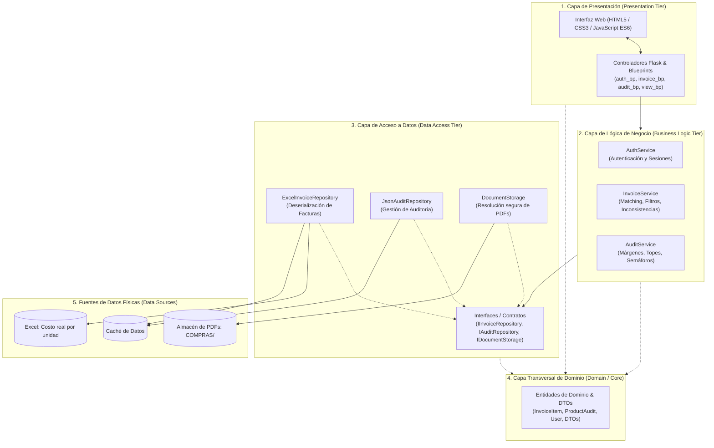

# Proyecto: Dashboard de Auditoría y Costos de Medicamentos GS
## Arquitectura en Capas (N-Layer / Multi-Tier Architecture)
**Curso:** Tecnologías de Construcción de Software  
**Referencia Teórica:** [*Layered (N-Layer) Architecture - Design Microservices Architecture with Patterns*](https://medium.com/design-microservices-architecture-with-patterns/layered-n-layer-architecture-e15ffdb7fa42)

---

## 1. Justificación y Fundamentos de la Arquitectura

La **Arquitectura en Capas (N-Layer Architecture)** es un patrón de diseño fundamental en la ingeniería de software que organiza el sistema en particiones lógicas horizontales, donde cada capa tiene un rol y una responsabilidad única y bien delimitada (*Separation of Concerns - SoC*).

### Reglas Clave Implementadas:
1. **Flujo de Dependencia Unidireccional:** Las capas superiores conocen a las inferiores, pero las capas inferiores nunca dependen de las capas superiores.
   $$\text{Presentación} \longrightarrow \text{Lógica de Negocio} \longrightarrow \text{Acceso a Datos} \longrightarrow \text{Fuentes de Datos}$$
2. **Desacoplamiento e Inversión de Dependencias:** La capa de negocio interactúa con la persistencia a través de contratos e interfaces abstractas (`abc.ABC`), permitiendo mockear la persistencia en pruebas unitarias o cambiar de motor de base de datos sin alterar la lógica de negocio.
3. **Capa Transversal de Dominio:** Los modelos y entidades del dominio (`InvoiceItem`, `ProductAudit`, `User`) fluyen entre las capas transportando el estado del negocio.

---

## 2. Diagrama de Arquitectura del Sistema



---

## 3. Estructura de Carpetas del Proyecto

```
layered_project/
├── requirements.txt            # Dependencias del proyecto
├── config.py                   # Configuración centralizada y variables de entorno
├── run.py                      # Punto de entrada principal (Factory & Inyección de Dependencias)
├── README.md                   # Documentación técnica de arquitectura
│
├── src/
│   ├── domain/                 # CAPA 1: MODELOS Y ENTIDADES DE DOMINIO
│   │   ├── models.py           # Entidades: InvoiceItem, ProductAudit, User, Indicadores
│   │   └── dtos.py             # DTOs: InvoiceFilterDTO, AuditFilterDTO, PaginatedResultDTO
│   │
│   ├── data_access/            # CAPA 2: ACCESO A DATOS Y PERSISTENCIA
│   │   ├── interfaces.py       # Interfaces abstractas (IInvoiceRepository, etc.)
│   │   ├── excel_invoice_repo.py # Repositorio de facturas
│   │   ├── json_audit_repo.py  # Repositorio de auditoría
│   │   └── document_storage.py # Acceso seguro a PDFs (evita Directory Traversal)
│   │
│   ├── business/               # CAPA 3: LÓGICA DE NEGOCIO Y SERVICIOS
│   │   ├── auth_service.py     # Autenticación y reglas de seguridad
│   │   ├── invoice_service.py  # Búsqueda difusa, cálculo de costos e inconsistencias
│   │   └── audit_service.py    # Reglas de negocio de auditoría y márgenes comerciales
│   │
│   └── presentation/           # CAPA 4: PRESENTACIÓN (API, UI Y VISTAS)
│       ├── controllers/        # Controladores REST modulares (Flask Blueprints)
│       │   ├── auth_controller.py
│       │   ├── invoice_controller.py
│       │   ├── audit_controller.py
│       │   └── view_controller.py
│       ├── templates/          # Vistas HTML Jinja2 (base.html, login.html, index.html)
│       └── static/             # Assets estáticos
│           ├── css/style.css
│           └── js/
│               ├── app.js
│               └── audit.js
│
└── tests/                      # SUITE DE PRUEBAS AUTOMATIZADAS
    ├── test_domain.py          # Pruebas de entidades de dominio
    ├── test_data_access.py     # Pruebas de repositorios y seguridad de paths
    ├── test_business_services.py # Pruebas aisladas de lógica de negocio (usando Mocks)
    └── test_presentation.py    # Pruebas de integración de endpoints HTTP
```

---

## 4. Guía de Ejecución

### Prerrequisitos
Instalar las dependencias necesarias:
```bash
pip install -r requirements.txt
```

### Ejecutar la Aplicación
```bash
python run.py
```
El servidor se iniciará en `http://localhost:8000/`.

**Credenciales por defecto:**
- **Usuario:** `admin`
- **Contraseña:** `admin123`

### Ejecutar la Suite de Pruebas Unitarias
Para verificar el aislamiento y correcto funcionamiento de todas las capas:
```bash
python -m unittest discover tests
```
O con `pytest`:
```bash
pytest tests/
```

---

## 5. Comparativa: Proyecto Original vs. Proyecto N-Capas

| Aspecto | Proyecto Original (`dashboard_app/`) | Proyecto Refactorizado (`layered_project/`) |
| :--- | :--- | :--- |
| **Arquitectura** | Monolito procedural / scripts acoplados | **Arquitectura en 4 Capas (N-Tier)** |
| **Separación de Responsabilidades** | Endpoints mezclados con templates y filesystem | **Controladores $\rightarrow$ Servicios $\rightarrow$ Repositorios $\rightarrow$ Dominio** |
| **Manejo de Datos** | Lectura directa de archivos en controladores | **Interfaces y Repositorios con patrón Repository** |
| **Seguridad de Archivos** | `send_from_directory` sin validación de entidades | **`DocumentStorage` con protección contra Directory Traversal** |
| **Testabilidad** | Difícil de probar sin montar servidor y archivos reales | **Pruebas unitarias independientes con Mock Repositories** |
| **Inyección de Dependencias** | No implementada | **Cableado desacoplado mediante patrón Application Factory** |
