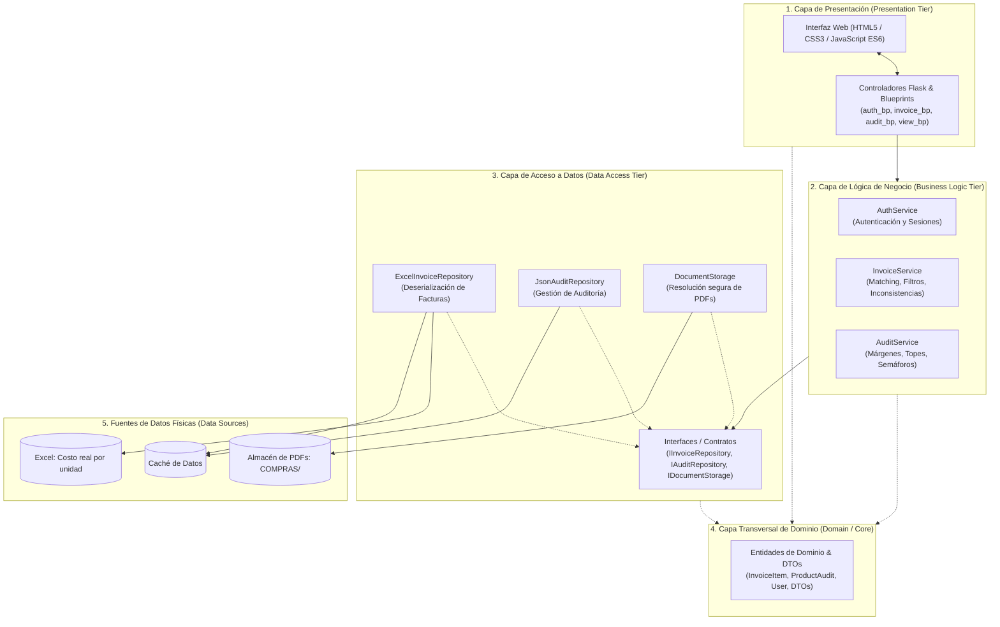
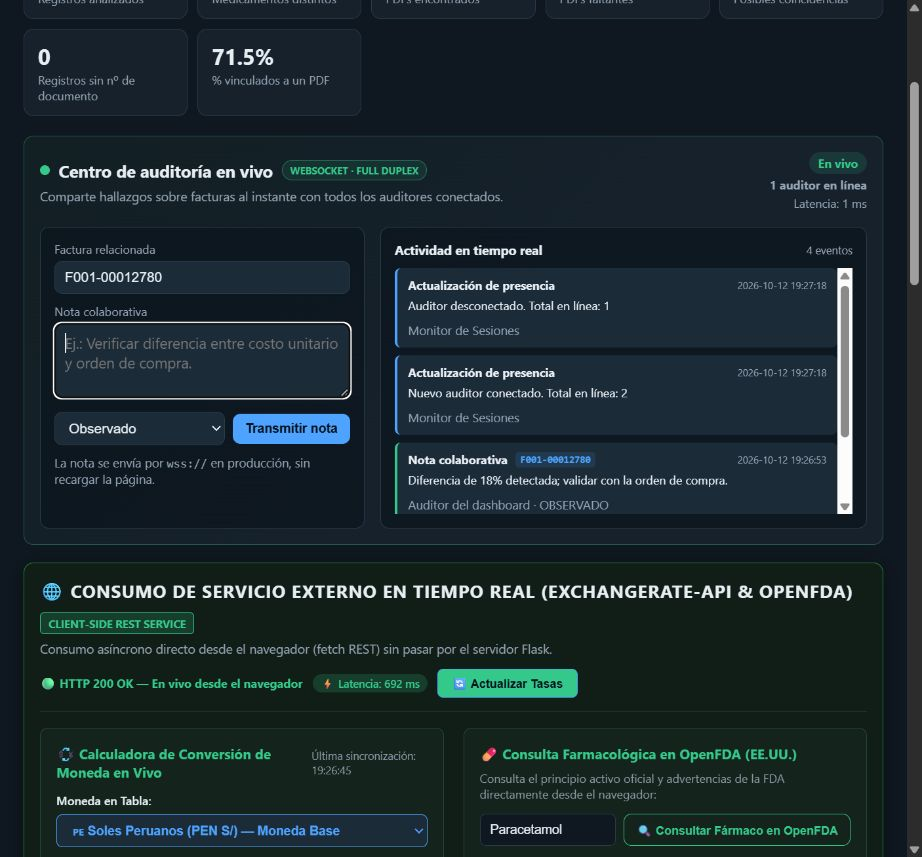

# Proyecto: Dashboard de Auditoría y Costos de Medicamentos GS
## Arquitectura en Capas (N-Layer / Multi-Tier Architecture)

[](https://render.com/deploy?repo=https://github.com/MelvinYabar/Tecnolog-as-de-Construcci-n-de-Software)
**Curso:** Tecnologías de Construcción de Software  
**Referencia Teórica:** [*Layered (N-Layer) Architecture - Design Microservices Architecture with Patterns*](https://medium.com/design-microservices-architecture-with-patterns/layered-n-layer-architecture-e15ffdb7fa42)

---

## 1. Justificación y Fundamentos de la Arquitectura

La **Arquitectura en Capas (N-Layer Architecture)** es un patrón de diseño fundamental en la ingeniería de software que organiza el sistema en particiones lógicas horizontales, donde cada capa tiene un rol y una responsabilidad única y bien delimitada (*Separation of Concerns - SoC*).

### Reglas Clave Implementadas:
1. **Flujo de Dependencia Unidireccional:** Las capas superiores conocen a las inferiores, pero las capas inferiores nunca dependen de las capas superiores.
   $$\text{Presentación} \longrightarrow \text{Lógica de Negocio} \longrightarrow \text{Acceso a Datos} \longrightarrow \text{Fuentes de Datos}$$
2. **Desacoplamiento e Inversión de Dependencias:** La capa de negocio interactúa con la persistencia a través de contratos e interfaces abstractas (`abc.ABC`), permitiendo mockear la persistencia en pruebas unitarias o cambiar de motor de base de datos sin alterar la lógica de negocio.
3. **Capa Transversal de Dominio:** Los modelos y entidades del dominio (`InvoiceItem`, `ProductAudit`, `User`) fluyen entre las capas transportando el estado del negocio.

---

## 2. Diagrama de Arquitectura del Sistema



---

## 3. Estructura de Carpetas del Proyecto

```
layered_project/
├── requirements.txt            # Dependencias del proyecto
├── config.py                   # Configuración centralizada y variables de entorno
├── run.py                      # Punto de entrada principal (Factory & Inyección de Dependencias)
├── README.md                   # Documentación técnica de arquitectura
│
├── src/
│   ├── domain/                 # CAPA 1: MODELOS Y ENTIDADES DE DOMINIO
│   │   ├── models.py           # Entidades: InvoiceItem, ProductAudit, User, Indicadores
│   │   └── dtos.py             # DTOs: InvoiceFilterDTO, AuditFilterDTO, PaginatedResultDTO
│   │
│   ├── data_access/            # CAPA 2: ACCESO A DATOS Y PERSISTENCIA
│   │   ├── interfaces.py       # Interfaces abstractas (IInvoiceRepository, etc.)
│   │   ├── excel_invoice_repo.py # Repositorio de facturas
│   │   ├── json_audit_repo.py  # Repositorio de auditoría
│   │   └── document_storage.py # Acceso seguro a PDFs (evita Directory Traversal)
│   │
│   ├── business/               # CAPA 3: LÓGICA DE NEGOCIO Y SERVICIOS
│   │   ├── auth_service.py     # Autenticación y reglas de seguridad
│   │   ├── invoice_service.py  # Búsqueda difusa, cálculo de costos e inconsistencias
│   │   └── audit_service.py    # Reglas de negocio de auditoría y márgenes comerciales
│   │
│   └── presentation/           # CAPA 4: PRESENTACIÓN (API, UI Y VISTAS)
│       ├── controllers/        # Controladores REST modulares (Flask Blueprints)
│       │   ├── auth_controller.py
│       │   ├── invoice_controller.py
│       │   ├── audit_controller.py
│       │   └── view_controller.py
│       ├── templates/          # Vistas HTML Jinja2 (base.html, login.html, index.html)
│       └── static/             # Assets estáticos
│           ├── css/style.css
│           └── js/
│               ├── app.js
│               └── audit.js
│
└── tests/                      # SUITE DE PRUEBAS AUTOMATIZADAS
    ├── test_domain.py          # Pruebas de entidades de dominio
    ├── test_data_access.py     # Pruebas de repositorios y seguridad de paths
    ├── test_business_services.py # Pruebas aisladas de lógica de negocio (usando Mocks)
    └── test_presentation.py    # Pruebas de integración de endpoints HTTP
```

---

## 4. Guía de Ejecución

### Prerrequisitos
Instalar las dependencias necesarias:
```bash
pip install -r requirements.txt
```

### Ejecutar la Aplicación
```bash
python run.py
```
El servidor se iniciará en `http://localhost:8000/`.

**Credenciales por defecto:**
- **Usuario:** `admin`
- **Contraseña:** `admin123`

### Ejecutar la Suite de Pruebas Unitarias
Para verificar el aislamiento y correcto funcionamiento de todas las capas:
```bash
python -m unittest discover tests
```
O con `pytest`:
```bash
pytest tests/
```

---

## 5. Comparativa: Proyecto Original vs. Proyecto N-Capas

| Aspecto | Proyecto Original (`dashboard_app/`) | Proyecto Refactorizado (`layered_project/`) |
| :--- | :--- | :--- |
| **Arquitectura** | Monolito procedural / scripts acoplados | **Arquitectura en 4 Capas (N-Tier)** |
| **Separación de Responsabilidades** | Endpoints mezclados con templates y filesystem | **Controladores $\rightarrow$ Servicios $\rightarrow$ Repositorios $\rightarrow$ Dominio** |
| **Manejo de Datos** | Lectura directa de archivos en controladores | **Interfaces y Repositorios con patrón Repository** |
| **Seguridad de Archivos** | `send_from_directory` sin validación de entidades | **`DocumentStorage` con protección contra Directory Traversal** |
| **Testabilidad** | Difícil de probar sin montar servidor y archivos reales | **Pruebas unitarias independientes con Mock Repositories** |
| **Inyección de Dependencias** | No implementada | **Cableado desacoplado mediante patrón Application Factory** |

---

## 6. Funciones Stateful y Stateless Implementadas

Como parte de los fundamentos de construcción de software, el proyecto cuenta con funciones formalmente categorizadas en la capa de negocio:

### A. Funciones Stateless (Sin Estado / Puras)
No dependen ni mutan ningún estado fuera de su alcance. Dado un mismo conjunto de argumentos, siempre retornan exactamente el mismo resultado (determinismo e idempotencia sin efectos secundarios):
1. **`normalize_product_name_stateless(raw_name: str) -> str`:**
   - Normaliza cadenas de texto (eliminación de tildes mediante Unicode NFKD, supresión de caracteres especiales y conversión a minúsculas).
2. **`calculate_unit_cost_stateless(importe_total: float, unidades_totales: float) -> Optional[float]`:**
   - Realiza el cálculo aritmético determinista del costo por unidad protegiendo contra divisiones por cero y datos corruptos.

### B. Funciones Stateful (Con Estado)
Dependen de un estado persistente o mutan variables de memoria/sesión entre invocaciones sucesivas:
1. **`track_invoice_view_stateful(invoice_id: int) -> int`:**
   - Acumula y modifica el contador de visualizaciones en la memoria del servicio (`self._view_counter`), variando su valor devuelto en cada llamada sucesiva.
2. **`add_search_history_stateful(session_store: dict, query: str) -> List[str]`:**
   - Modifica el historial de búsquedas del usuario almacenado en la sesión web (`session['search_history']`), manteniendo una cola cronológica de las últimas consultas.

---

## 7. Internacionalización (i18n) con Menú Desplegable

El proyecto implementa un módulo desacoplado de internacionalización en la capa de negocio (`src/business/i18n_service.py`):
- **Idiomas Soportados:** Español (`es`, por defecto), Inglés (`en`) y Portugués (`pt`).
- **Menú Desplegable de Selección (`<select>`):** Selector estandarizado presente en el encabezado del Dashboard, en el formulario de inicio de sesión y en la vista de demostración de funciones (`<select id="langSelect" onchange="window.location.href='/set-lang/' + this.value">`).
- **Mecanismo de Detección:** Vía parámetro URL `?lang=<code>` o persistido en la sesión HTTP (`session['lang']`).
- **Fallback Jerárquico:** Si una clave o idioma no está disponible, el sistema aplica fallback automático al idioma base (`es`) sin interrumpir la ejecución.
- **Sincronización Frontend/Backend:** Los textos dinámicos generados en JavaScript (`app.js`, `regex-validator.js`) y las plantillas Jinja2 se traducen reactivamente manteniendo consistencia en todas las vistas.
- **Pruebas Automatizadas:** `tests/test_i18n.py` con pruebas unitarias exhaustivas del catálogo multilingüe y resolución de cadenas con parámetros dinámicos.

---

## 8. Validación de Formularios con Expresiones Regulares (Regex)

El sistema incorpora un motor de validación formal en dos niveles (cliente y servidor) basado en Expresiones Regulares en la capa de negocio (`src/business/validator_service.py` -> `RegexValidatorService`) y en la capa de presentación (`regex-validator.js` y endpoint `POST /api/invoices/validate-form`):

| Campo | Expresión Regular (Regex) | Descripción y Regla de Negocio | Ejemplo Válido |
| :--- | :--- | :--- | :--- |
| **Número de Factura** | `^[A-Z0-9]{1,5}-\d{4,8}$` | Serie de 1 a 5 caracteres alfanuméricos, guion y correlativo de 4 a 8 dígitos | `F002-00012780` |
| **RUC del Proveedor** | `^(10\|20)\d{9}$` | 11 dígitos numéricos estrictos, iniciando en 10 (persona) o 20 (empresa) | `20100123456` |
| **Registro Sanitario** | `^[A-Z]{1,3}-\d{4,8}$` | Prefijo farmacéutico (1-3 letras), guion y código numérico (4-8 dígitos) | `EE-04821` |
| **Fecha de Emisión** | `^\d{4}-(0[1-9]\|1[0-2])-(0[1-9]\|[12]\d\|3[01])$` | Formato estándar ISO `AAAA-MM-DD` con mes y día válidos | `2026-06-15` |
| **Correo Electrónico** | `^[a-zA-Z0-9_.+-]+@[a-zA-Z0-9-]+\.[a-zA-Z0-9-.]+$` | Formato de correo corporativo para auditoría con usuario, `@` y dominio | `auditoria@farmacia.com` |
| **Importe Total** | `^\d+(\.\d{1,4})?$` | Valor numérico positivo con hasta 4 decimales opcionales | `12450.75` |
| **Nombre de Archivo PDF** | `^[\w\s.-]+\.(pdf\|PDF)$` | Nombre de archivo terminado estrictamente en extensión `.pdf` o `.PDF` | `F002-00012780 08.06.pdf` |

### Características de la Implementación:
1. **Validación en Tiempo Real (Cliente):** Escucha eventos `input` y `blur`, tiñendo los campos de verde (`✔ Válido`) o rojo (`✖ Inválido`) con su respectivo mensaje explicativo.
2. **Validación de Servidor (Capa de Negocio):** Endpoint `POST /api/invoices/validate-form` que ejecuta `RegexValidatorService.validate_invoice_form()` y devuelve el diagnóstico completo en formato JSON con código `HTTP 200 OK`.
3. **Botones de Demostración Rápida:**
   - **`✔ Cargar Ejemplo Válido`**: Carga datos que cumplen todas las expresiones regulares.
   - **`✖ Cargar Ejemplo con Errores`**: Carga datos intencionalmente corruptos para evidenciar la detección y rechazo por Regex.
   - **`🧹 Limpiar`**: Restablece el formulario a su estado inicial.
4. **Pruebas Automatizadas:** `tests/test_regex_validation.py` con 11 pruebas unitarias cubriendo cada regex individual, validación de formularios completos y endpoints HTTP.

---

## 9. Diagrama de Componentes UML (UML 2.5)

El sistema cuenta con un modelado formal de componentes según el estándar **UML 2.5** documentado detalladamente en [`docs/DIAGRAMA_COMPONENTES.md`](docs/DIAGRAMA_COMPONENTES.md), detallando:
- **Componentes por Capa:** Controladores cliente/servidor, servicios de negocio, repositorios de acceso a datos y entidades de dominio.
- **Interfaces Provistas y Requeridas:** Matriz de contratos (`IInvoiceRepository`, `IAuditRepository`, `IDocumentStorage`, `IInvoiceService`, APIs REST).
- **Puertos y Dependencias Externas:** Integración del componente de cliente `ExternalServiceController` consumiendo servicios en la nube vía HTTPS.

---

## 10. Consumo de Servicios Externos en Tiempo Real desde el Front End

Siguiendo la consigna de consumir servicios externos **directamente desde el front end** (en el navegador del cliente mediante JavaScript `fetch` asíncrono, sin intermediación del servidor Flask):

1. **ExchangeRate-API (`https://open.er-api.com/v6/latest/PEN`):**
   - **Propósito:** Conversión dinámica y en tiempo real de los importes y costos unitarios de medicamentos de Soles (`PEN S/`) a Dólares Americanos (`USD $`), Euros (`EUR €`) y Reales Brasileños (`BRL R$`).
   - **Indicador Ticker en Vivo:** Widget en la cabecera mostrando el tipo de cambio oficial actualizado.
   - **Selector de Moneda en Tabla:** Al alternar la divisa (`PEN`, `USD`, `EUR`), la tabla completa y el panel de detalle recalculan automáticamente los precios con la tasa obtenida en vivo.
   - **Consola del Servicio Externo:** Muestra el endpoint REST consultado, código `HTTP 200 OK`, tiempo de respuesta / latencia en milisegundos (`performance.now()`), calculadora de conversión y el payload JSON devuelto directamente por la API externa.

2. **OpenFDA Drug API (`https://api.fda.gov/drug/label.json`):**
   - **Propósito:** Consulta farmacológica internacional en tiempo real con datos oficiales de la FDA (principios activos, indicaciones y advertencias) al hacer clic en un medicamento.

---

## 11. WebSockets: Centro de Auditoría en Vivo

Se agregó un canal **WebSocket full-duplex** en `/ws/audit` para colaboración simultánea entre auditores. A diferencia de una API REST tradicional, la conexión permanece abierta y el servidor puede difundir eventos a todos los navegadores conectados sin sondeo ni recarga de página.

### Uso dentro de la aplicación

1. Inicie sesión y ubique el panel **Centro de auditoría en vivo** en la parte superior del dashboard.
2. Confirme el indicador verde **En vivo**, el número de auditores conectados y la latencia `PING/PONG`.
3. Ingrese el número de factura, una nota y su estado (`En revisión`, `Observado` o `Resuelto`).
4. Pulse **Transmitir nota**. Todos los auditores conectados reciben el hallazgo inmediatamente en su feed de actividad.
5. Si la red se interrumpe, el cliente intenta reconectarse automáticamente con espera exponencial.

La implementación mantiene la arquitectura en capas: `websocket_controller.py` adapta el transporte, `WebSocketBroadcasterService` administra conexiones, presencia, historial y difusión thread-safe, y `websocket-audit.js` controla la experiencia del navegador.



---

## 12. Despliegue en Render

El repositorio incluye `render.yaml`, un conjunto JSON **ficticio** para la demostración pública y una ruta de salud `/healthz`. Los datos reales permanecen únicamente en el workspace local y no se publican. Render ejecuta Gunicorn con un proceso y ocho hilos para mantener conexiones WebSocket concurrentes. Las conexiones locales usan `ws://` y en producción el cliente selecciona automáticamente `wss://`.

Para crear el servicio desde este repositorio, importe el Blueprint en Render. `SECRET_KEY` y `DASHBOARD_PASSWORD` se generan como secretos aleatorios durante la creación; el usuario puede consultar o reemplazar la contraseña desde el panel de variables de entorno. Las demás variables y el comando de producción ya están declarados en `render.yaml`.


